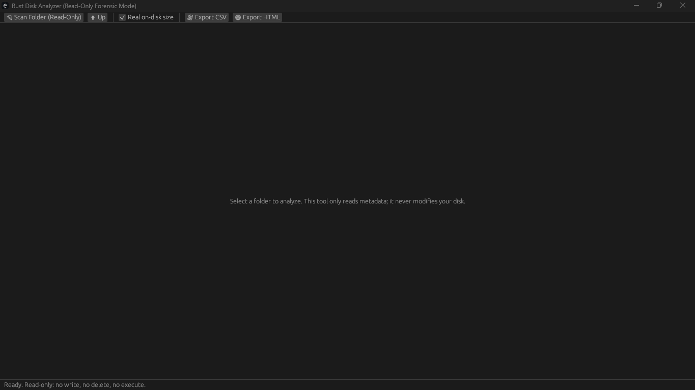
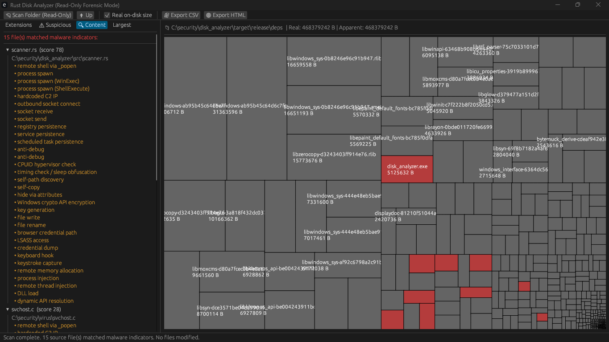
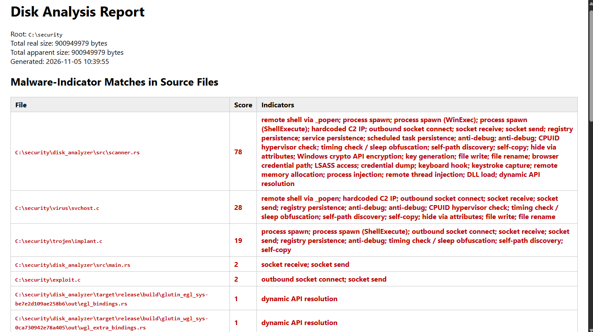

# Rust Disk Analyzer (Read-Only Forensic Mode)

A cross-platform desktop disk analysis tool built with **Rust + egui**. Designed for students and cybersecurity learners who need to understand what is consuming disk space **and identify potentially malicious source code — without ever modifying, deleting, compiling, or executing anything on the target disk**.

The tool scans directories, renders an interactive treemap, aggregates files by extension, flags executable/script file types, performs **read-only content scanning of source code for malware indicators**, and exports CSV/HTML reports.



---

## ✨ Features

### Core
- **Interactive treemap** — squarified binary-split layout. Colour-coded:
  - 🔵 Blue — folder (click to drill in)
  - ⬜ Gray — ordinary file
  - 🔴 Red — executable/script extension (`.exe`, `.ps1`, `.dll`, …)
  - 🟠 Orange — reviewable source code (`.c`, `.py`, `.ps1`, …)
  - 🟥 Dark red — source file that **matched malware indicators**
  - 🟡 Amber — symlink / reparse point (never followed)
- **Drill-down navigation** — click any folder rectangle to enter it; **⬆ Up** to return.
- **Parallel scanning** — uses `rayon` for concurrent subdirectory traversal; scan runs on a **background thread** so the UI never freezes, even on `C:\`.
- **Real on-disk size vs. apparent size** — toggle between `GetCompressedFileSizeW` (actual bytes allocated, handles NTFS compression/sparse files) and `metadata.len()` (logical size). Matches what Explorer's Properties dialog shows.

### Safety
- **Read-only by design** — no write, delete, rename, move, compile, or execute operations anywhere in the codebase.
- **Symlink / reparse point protection** — detected via `symlink_metadata()` and recorded as zero-byte leaf nodes. Never traversed, preventing infinite loops and double-counting.
- **No admin elevation required** — runs with normal user privileges; unreadable entries are silently skipped.
- **Content scanner is passive** — reads source files as UTF-8 text only. Never invokes a compiler, interpreter, or shell.

### Analysis
- **Extension aggregation sidebar** — total size and file count per extension across the current subtree.
- **⚠ Suspicious tab** — two sections:
  - Executable/script extensions highlighted in red: `.exe .scr .pif .com .msi .dll .cpl .ocx .sys .bat .cmd .ps1 .psm1 .vbs .vbe .js .jse .wsf .wsh .hta .sh .jar .apk .lnk .reg .inf .docm .xlsm .pptm .dotm .xlam .zip .rar .7z .iso .img .vhd .vhdx`
  - Source code extensions flagged for review in amber: `.c .h .cpp .cc .cxx .hpp .asm .s .rs .py .rb .pl .php .lua .go .cs .java .vb .vbs .sh .bash .ps1 .bat .cmd`
- **🔍 Content tab** — scans reviewable source files for 33 malware indicators (remote shell, C2, persistence, anti-debug, injection, credential theft, ransomware crypto, keylogging). Files are **scored by weight** and listed with the matched indicator labels. Files scoring ≥ 10 auto-expand.
- **Largest files tab** — top 50 files by real size in the current view.

### Reporting
- **CSV export** — full recursive dump with `path, name, is_dir, real_bytes, apparent_bytes, ext, is_link`.
- **HTML export** — single self-contained offline report with totals, timestamp, malware-indicator table, suspicious-extension table, and full extension breakdown. Suitable for lab submission or archiving.
- **Persistent status bar** — always shows the current operation, scan results, and the "read-only / no modification" guarantee.

---

## 🖼️ Screenshots

### Treemap view with colour-coded analysis


### Suspicious extension aggregation


### Content scan detecting malware source


### HTML report export


---

## 🚀 Getting Started

### Prerequisites

- Rust toolchain 1.75 or newer (`rustup update`)
- **Windows**: MSVC build tools (installed automatically by `rustup`)
- **Linux**: `libxcb`, `libxkbcommon`, `libwayland`
  ```bash
  sudo apt install libxcb-render0-dev libxcb-shape0-dev libxcb-xfixes0-dev \ libxkbcommon-dev libwayland-dev